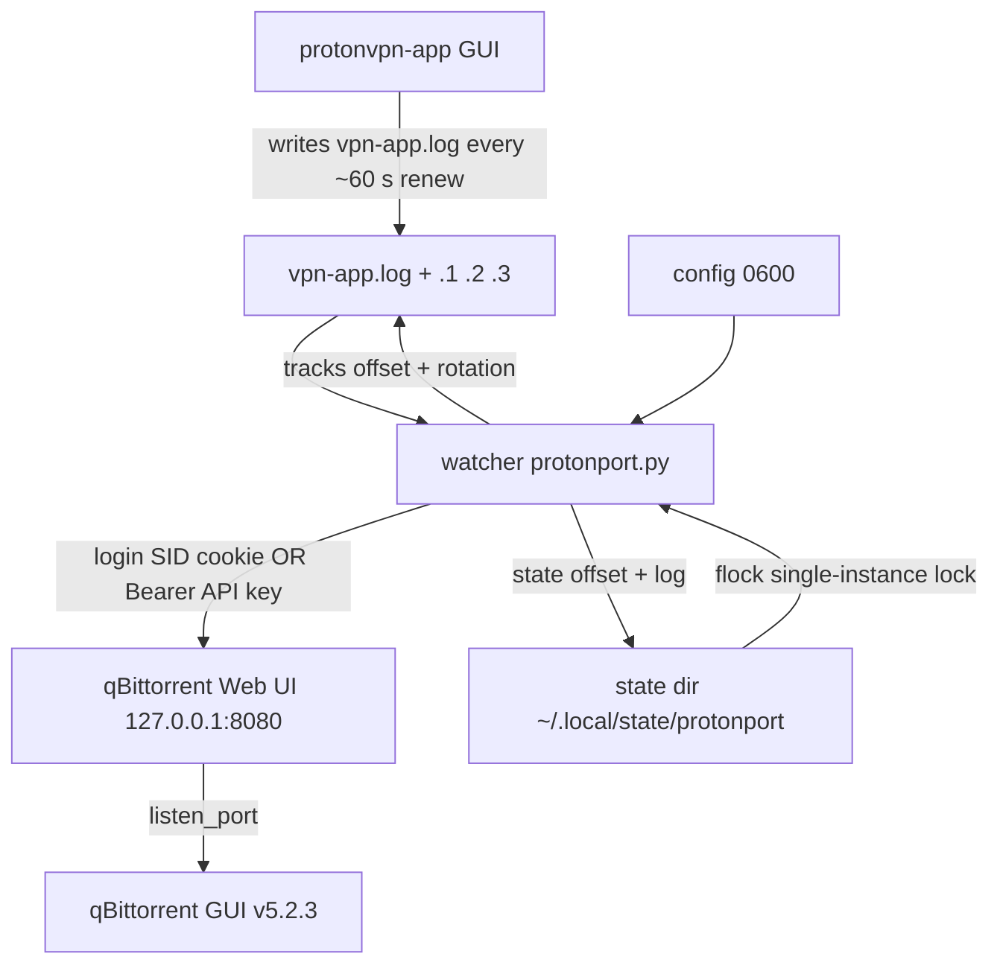

# DESIGN - Automatic qBittorrent listen-port updater based on ProtonVPN port forwarding

**Status:** Design / specification for implementation.
**Target platform:** Linux (CachyOS/Arch, KDE, systemd --user).
**Purpose of the document:** the single source of truth for the Code-mode implementation without further questions. It contains no solution code, only the design, algorithms, regexes, schemas and the complete content of the configuration/system files that the Code mode must create.

---

## 1. Overview and goal

A background program (further: **watcher**) runs as a user-level process. Its only purpose:

1. Watch the log of the `protonvpn-app` application (`vpn-app.log`), which holds the information about the **forwarded port** assigned by ProtonVPN (port forwarding).
2. When this port changes (a new assignment after a reconnect), **set the same port as the qBittorrent listen port** through the Web API (`/api/v2/app/setPreferences`, the `listen_port` parameter).
3. At startup run a **self-healing synchronization** - find the current forwarded port from the log and the current `listen_port` from qBittorrent and fix it right away if needed.

The key finding from the research on which the design is based:

- The forwarded port exists **only in the log** `~/.cache/Proton/VPN/logs/vpn-app.log`; there is no machine-readable state file with the port.
- During a single connection the port is **stable**; it is renewed (renew) roughly every 60 s and changes **only after a reconnect**.
- On a running GUI qBittorrent, `Session\Port` changes **only through the Web API** (or by a restart) - overwriting the config file at runtime is not enough (the GUI would overwrite it on exit).

---

## 2. Implementation language decision

### Choice: **Python 3, pure standard library** (`urllib.request`, `json`, `re`, `os`, `time`, `fcntl`, `logging`, `argparse`).

### Rationale

| Criterion | Python 3 (stdlib) | bash + curl + jq |
|---|---|---|
| New dependencies | **0** (python3 = 3.14.7 is guaranteed on the system - the protonvpn-app runs on it too) | 0, but relies on the external binaries `curl`/`jq` (present, but they are more moving parts) |
| Log parsing / follow-by-offset | Trivial: `open(..., 'rb')`, `seek`, `read`, byte buffer | Ugly and error-prone (sizes, sub-files, binary offset handling in bash) |
| HTTP + cookies (qBittorrent, `SID` session) | `http.cookiejar.CookieJar` + `urllib` - native cookie management | Manual handling of the `Cookie: SID=...` header in `curl -b/-c` files |
| JSON (preferences, setPreferences) | `json` module - no manual escaping | Escaping JSON for the `json=` form field is highly error-prone in bash |
| Backoff / state machine / rotation | Natural code with variables and functions | `sleep`, flags, many branches - hard to follow |
| Single-instance lock | `fcntl.flock` - a few lines | Does not exist without extra tricks (flock binary) |
| Readability / maintainability | High | Low for this kind of logic |

**Decision:** Python 3, pure stdlib. A single script = **0 new dependencies** (python3 is already installed and guaranteed). HTTP is done with `urllib.request` - no need to invoke `curl`/`jq` from an external process (even though they are on the system). The robustness of follow-the-log + rotation detection and the readability are significantly better in Python than in bash.

### Consequences for the implementation
- Shebang: `#!/usr/bin/env python3`.
- **Forbidden imports outside the stdlib:** no `requests`, `yaml`, `toml`, `inotify`, etc. The watcher uses **polling** (`time.sleep`), not inotify - 0 dependencies and simpler code. An interval of ~15 s is perfectly sufficient for a ~60 s renewal cycle.
- Python 3.9+ APIs (types, `dict` merge) - at 3.14 there is no need to worry about old versions.

---

## 3. Architecture



Data flow:
1. On a renewal (every ~60 s) and on a new assignment (reconnect), `protonvpn-app` writes a `Receiving Response { ... internal_port: NNNNN, external_port: NNNNN, ... }` line into the log.
2. The watcher reads the log from the stored byte offset and extracts the port with a regex.
3. It compares the port with the current `listen_port` in qBittorrent (GET `/api/v2/app/preferences`).
4. If they differ - POST `/api/v2/app/setPreferences` with `{"listen_port": <port>}`.
5. At startup and after a rotation it catches up / self-heals from the log tail.

---

## 4. Target project file structure

The project working folder contains **spaces** (`qBittorrent port updater for ProtonVPN`) - therefore the runtime files are installed into **space-free** paths (`~/.local/bin`, `~/.config/...`, `~/.local/state/...`). The structure the Code mode must create in the workspace root:

```
qBittorrent port updater for ProtonVPN/   <- workspace (a path with spaces)
├── DESIGN.md                 <- this file (specification)
├── README.md                 <- concise overview: purpose, install, usage, troubleshooting
├── LICENSE                   <- MIT (optional, recommended)
├── protonport.py             <- THE ONLY runtime script (Python 3, pure stdlib)
├── protonport.conf.example   <- config template with a password placeholder (mode 0644, NEVER with a password)
├── protonport.service        <- systemd --user unit (template for install to ~/.config/systemd/user)
├── install.sh                <- installer/uninstaller helper
├── tests/
│   └── test_protonport.py    <- stdlib unittest suite (fake qBittorrent Web API)
└── .github/workflows/ci.yml  <- ruff + pylint (errors only) + tests
```

**Target (installed) runtime locations** (space-free, recommended and used in the systemd unit):

| File | Target | Mode |
|---|---|---|
| script | `~/.local/bin/protonport.py` | `0700` |
| config | `~/.config/protonport/protonport.conf` | `0600` |
| state/offset/lock | `~/.local/state/protonport/` | `0700` (directory) |
| systemd unit | `~/.config/systemd/user/protonport.service` | `0644` |

> Note on spaces in the path: the recommended installation **copies** the script to `~/.local/bin/protonport.py`. This lets the `ExecStart` in the systemd unit avoid any space escaping (systemd would otherwise require `\x20`). If a user insists on running directly from the workspace, the whole path in `ExecStart` must be enclosed in double quotes and the spaces kept as they are (systemd 250+ handles that), see §10.5.

---

## 5. Configuration

### 5.1 Format and location
- Format **JSON** (parsed with the pure stdlib `json`).
- Runtime config: `~/.config/protonport/protonport.conf`, mode **0600**, owner = the user.
- Template in the repository: `protonport.conf.example` (contains the `__CHANGE_ME__` placeholder, never a real password). Installation: copy and fill in the credentials.
- The password/API key are **never in the code or in the repository**. They are only in the config (0600) or optionally in the `PROTONPORT_QBIT_PASSWORD` / `PROTONPORT_QBIT_API_KEY` env variables, which take priority (they let you keep the secrets off the disk entirely). The code contains no default secret.
- Value precedence: **command line** (the `--dry-run`, `--force`, `--config` switches) > **env** (password/API key) > **JSON config** > **built-in defaults**.
- Validation at startup: unknown keys, wrong types and invalid values (e.g. a non-http(s) `base_url`) - error (protection against typos); **missing keys use the built-in defaults** (a partial `qbittorrent`/`intervals` section is valid); a password equal to the placeholder or empty while env is not set - **refuse to start** with instructions (exit code 78).

### 5.2 JSON config schema

```jsonc
{
  // Paths
  "log_path": "~/.cache/Proton/VPN/logs/vpn-app.log",
  "state_dir": "~/.local/state/protonport",
  "own_log_file": "",            // empty => log to stdout/stderr (journalctl); otherwise a path for the nohup mode

  // Logging
  "log_level": "INFO",           // DEBUG | INFO | WARNING | ERROR

  // qBittorrent Web UI
  "qbittorrent": {
    "base_url": "http://127.0.0.1:8080",
    //   HTTPS Web UI: use https://127.0.0.1:8080 (the port does not change) + insecure_https: true
    "username": "user",          // only for the user/password mode
    "password": "__CHANGE_ME__", // only for the user/password mode (config/env)
    "api_key": "",               // preferred: Bearer API key (then the password is ignored)
    "http_timeout_s": 10,
    "insecure_https": false      // true: self-signed HTTPS cert (loopback) - do not verify SSL
  },

  // Intervals / retry (seconds)
  "intervals": {
    "connected_s": 15,             // log poll while the log exists and we read it
    "offline_s": 60,               // poll when the log does not exist / VPN is not connected
    "reconcile_s": 300,            // periodic comparison even when the log port does not change
    "qbit_backoff_base_s": 5,      // qBittorrent unavailable
    "qbit_backoff_max_s": 120,
    "auth_backoff_base_s": 60,     // bad login (do not hammer a ban)
    "auth_backoff_max_s": 600
  },

  // Behaviour
  "tail_scan_bytes": 1048576,      // how many bytes at the log tail to scan during self-healing (1 MiB)
  "dry_run": false,                // do not run setPreferences, only log what would happen
  "force_on_start": false          // self-healing at startup applies the port even when it matches qBittorrent
}
```

### 5.3 Example of a real `~/.config/protonport/protonport.conf` (after installation)

```json
{
  "log_path": "~/.cache/Proton/VPN/logs/vpn-app.log",
  "state_dir": "~/.local/state/protonport",
  "own_log_file": "",
  "log_level": "INFO",
  "qbittorrent": {
    "base_url": "http://127.0.0.1:8080",
    "username": "user",
    "password": "YOUR_REAL_PASSWORD",
    "http_timeout_s": 10
  },
  "intervals": {
    "connected_s": 15,
    "offline_s": 60,
    "reconcile_s": 300,
    "qbit_backoff_base_s": 5,
    "qbit_backoff_max_s": 120,
    "auth_backoff_base_s": 60,
    "auth_backoff_max_s": 600
  },
  "tail_scan_bytes": 1048576,
  "dry_run": false,
  "force_on_start": false
}
```

### 5.4 Script CLI
```
protonport.py [--config PATH] [--dry-run] [--force] [--once] [--check] [--version]
```
- `--config PATH` - path to the config (default `~/.config/protonport/protonport.conf`).
- `--dry-run` - overrides the config `dry_run` to true.
- `--force` - overrides `force_on_start` to true.
- `--once` - runs **one** synchronization cycle and exits (handy for testing / cron). It still does the follow and self-healing in a single pass. Returns `4` when the sync could not be confirmed (qBittorrent unavailable/backoff, no port in the log).
- `--check` - prints: does the log exist? the latest port from the log? the current `listen_port` from qBittorrent? connection state? then exits. A debugging tool; returns `4` on an out-of-sync port.
- Unknown switches -> usage on stderr + exit code 2.
- Config/credentials errors -> exit code 78 (`EX_CONFIG`; the systemd unit has `RestartPreventExitStatus=78` so it does not restart-loop).
- The lock/single-instance applies to all modes except `--check`.

---

## 6. Input data: log format and exact regexes

### 6.1 Line structure (authoritative facts)
```
<ISO-8601 UTC with microseconds> | <module/file:line> | <LEVEL> | <message>
```
The timestamps sort lexicographically (we use that only optionally; primarily we rely on the order within the file, not on parsing the time).

### 6.2 Samples (authoritative)
```
2026-09-08T15:40:55.489986+00:00 | proton.vpn.platform/port_forwarding.rs:240 | INFO | Receiving Response { version: 0, operation: 130, response_code: 0, gateway_epoch_seconds: 1828716, internal_port: 43991, external_port: 43991, lifetime_seconds: 60 }
2026-09-08T15:40:55.489986+00:00 | proton.vpn.platform/listener.rs:118 | INFO | Forwarded port updated.
```

### 6.3 Regexes (compiled once at startup, `re.MULTILINE` flag for safety; lines are split on `\n`)

**A) Port from the renew response - DIRECT port source** (used for the decision):
```python
PORT_RENEW_RE = re.compile(
    r"\|\s*proton\.vpn\.platform/port_forwarding\.rs:\d+\s*\|\s*\w+\s*\|\s*"
    r"Receiving Response\s*\{[^{}]*?internal_port:\s*(\d{1,5})[^{}]*?external_port:\s*(\d{1,5})"
)
```
- Catches **both a renewal** (operation 130, every ~60 s) **and a new assignment** after a reconnect - both are the same `Receiving Response` shape, just from the `port_forwarding.rs` module.
- Filtering by the `port_forwarding.rs` module **and** the `Receiving Response` text prevents collisions with other responses of the same shape (e.g. certificates).
- We capture both `internal_port` and `external_port`. In the Proton model they are equal (port forwarding without NAT). **`internal_port` is authoritative**; if `external_port` is missing/unequal, the port = `internal_port`, otherwise a WARNING is logged on a mismatch (an anomaly, unexpected).
- The `\d{1,5}` limit + an additional range validation 1024-65535; a port of `0` or out of range - ignore with a WARNING (prevents applying an invalid port).

**B) Marker of a new assignment - OBSERVABILITY ONLY** (it carries no port):
```python
ASSIGNED_RE = re.compile(r"\|\s*proton\.vpn\.platform/listener\.rs:\d+\s*\|\s*\w+\s*\|\s*Forwarded port updated\.?\s*")
```
- Not used for the decision (there is no port in it), only for an informative "new assignment detected" log. The actual apply is triggered from the renew line (A), which arrives within ~60 s.

**C) Optional connection markers - INFO ONLY, they DO NOT model the logic** (a clean disconnect has no reliable marker):
```python
CONNECTED_RE = re.compile(r"CONN:STATE_CHANGED\s*\|\s*Connected")
```

### 6.4 Fast-path filter
Before the full regex, the line is filtered quickly: if it contains neither `port_forwarding.rs` nor `Receiving Response`, the line is skipped without the regex (performance; the log is ~3 MiB).

---

## 7. Watcher algorithm

### 7.1 Persistent state
In `state_dir/protonport.state.json` (default `~/.local/state/protonport/protonport.state.json`), mode `0600`:

```jsonc
{
  "follow": {               // what we are currently watching (the vpn-app.log file)
    "dev": 2065,            // st_dev
    "ino": 9912345,         // st_ino
    "offset": 123456,       // byte offset where we stopped reading
    "prefix_sha256": "...", // SHA-256 of the first prefix_len bytes (copytruncate detection)
    "prefix_len": 256       // how many bytes the fingerprint covers (<= 256)
  },
  "last_seen_port": null,   // the last port we ever read from the log
  "last_applied_port": null // the last port actually sent to qBittorrent (null = unknown)
}
```
- The state is saved after every change (atomic: write to `.tmp` + `os.replace`).
- Corrupted/missing state - reset: `follow = null`, offset 0; a full startup self-healing runs (§7.4). No crash.

Single-instance lock: `state_dir/protonport.lock`, opened with `O_CREAT`, `fcntl.flock(LOCK_EX | LOCK_NB)`. On failure - log "another instance is running" and exit code 3 (§10.3).

### 7.2 Main loop (pseudocode)

```python
def main():
    cfg = load_config(argparse)          # §5; rejects the password placeholder
    lock = acquire_lock(cfg)             # flock; exit 3 when another instance holds it
    state = load_state(cfg)
    qbit = QBittorrent(cfg)              # cookie jar, base_url, timeout
    log = init_logger(cfg)

    if cfg.force_on_start or first_run(state):
        do_startup_sync(state, qbit, cfg)   # §7.4 self-healing

    while not cfg.once_done:
        try:
            st = os.stat(cfg.log_path)      # vpn-app.log
        except FileNotFoundError:
            log.warning("ProtonVPN log not found; the VPN app is probably not running.")
            qbit_deadline = backoff_state if needed
            sleep(cfg.intervals["offline_s"]); continue
        # ... (see 7.3)
        sleep(cfg.intervals["connected_s"])
```

### 7.3 Follow-the-log with rotation detection

Invariant: state.follow holds the `(dev, ino)` of the file we watch and `offset`, where we stopped reading.

```python
while True:
    st = os.stat(cfg.log_path)                      # current state of vpn-app.log
    cur = (st.st_dev, st.st_ino, st.st_size)

    if state.follow is None or \
       (state.follow["dev"], state.follow["ino"]) != (st.st_dev, st.st_ino):
        handle_file_change(state, st)               # rotation OR first start
        sleep(interval_connected); continue

    # TRUNCATION guard (copytruncate rotation variant, defense):
    if state.follow["offset"] > st.st_size:
        # the file was truncated (same inode, smaller size) - start over from 0
        reset_follow(state, offset=0)
        self_heal_from_tail(state, qbit, cfg)       # find the port again
        sleep(interval_connected); continue

    ports = read_new_lines(state)                    # §7.3.1; updates offset
    for p in ports:
        apply_port_if_needed(p, qbit, state, cfg)
    sleep(interval_connected)
```

#### 7.3.1 `read_new_lines` - safe reading without splitting lines/UTF-8

```python
def read_new_lines(state, cfg):
    f = open(cfg.log_path, "rb")
    info = os.fstat(f.fileno())
    if (info.st_dev, info.st_ino) != (state.follow["dev"], state.follow["ino"]):
        f.close()
        return []                    # the file changed between stat and open - let the main loop handle the rotation
    f.seek(state.follow["offset"])
    data = f.read()                  # up to EOF
    state.follow["offset"] = info.st_size
    f.close()

    raw = state.pending_bytes + data
    idx = raw.rfind(b"\n")
    if idx == -1:                    # no complete line
        state.pending_bytes = raw
        return []
    chunk, state.pending_bytes = raw[: idx + 1], raw[idx + 1 :]

    ports = []
    for line in chunk.split(b"\n")[:-1]:
        p = extract_port(line)       # §6.3 regex A (+ range validation)
        if p is not None:
            ports.append(p)
    save_state(state)
    return ports
```

**Important details:**
- Reading is **byte-based** (`seek`/`offset`); the buffer is kept **binary** (`pending_bytes`) and is only split after `\n` (ASCII) - a UTF-8 character is never split.
- The `offset` is written immediately after reading (even if the port is not processed) - the follow must not read history again.
- An incomplete trailing line (no `\n`) stays in `pending_bytes` until the next tick.

#### 7.3.2 `handle_file_change` - rotation

Because the port is stable and the renewal runs every ~60 s, the tolerance for losing a boundary line is high (the next renewal within 60 s fixes the state). Still, we implement the **primary, exact approach** without gaps + a fallback:

```python
def handle_file_change(state, st):
    old = state.follow
    # 1) We were in the middle of following and the file was replaced => a rename-type
    #    rotation: the old content is now in vpn-app.log.1 (the youngest archive).
    #    Read from our offset to EOF.
    if old is not None:
        p1 = cfg.log_path + ".1"
        try:
            f1 = open(p1, "rb")
            i1 = os.fstat(f1.fileno())
            if (i1.st_dev, i1.st_ino) == (old["dev"], old["ino"]):
                # confirmed rename: read the rest of the old file
                f1.seek(old["offset"])
                for p in parse_all(f1.read()):
                    apply_port_if_needed(p, ...)     # process the boundary events too
            f1.close()
        except FileNotFoundError:
            pass                     # the fallback below finds the port again anyway
    # 2) New vpn-app.log (different inode) - follow from the start.
    state.follow = {"dev": st.st_dev, "ino": st.st_ino, "offset": 0}
    # 3) Fallback/self-healing: if we found no port during the rotation, the tail-scan
    #    restores the current state (§7.4). It runs only when last_seen is None.
```

Note: for the **copytruncate** type (same inode, truncation) the size guard (`offset > size`) alone is not reliable - the file can be truncated and grow back past the old offset between two ticks. Therefore the state also stores `prefix_sha256` (SHA-256 of the first 256 bytes of the watched file). A changed prefix means the file was truncated/rewritten: the offset is reset to 0, the binary buffer is dropped and a tail-scan self-heals the port. A state file from an older version (no fingerprint) is migrated on the first tick without a reset.

#### 7.3.3 "Empty / very new log" detection
The tail-scan (§7.4) runs when we still know no port after reading (`last_seen_port is None`) - this also covers the case when `vpn-app.log` has just been emptied/is new and the real state is in `.log.1`.

### 7.4 Startup synchronization / self-healing

Goal: after a start, and then periodically, bring qBittorrent in sync with the current forwarded port, even if nothing changes while the program runs.

Besides the startup call, the same self-healing runs every `reconcile_s` (default 300 s) and after any rotation/truncation. That catches a manual change in qBittorrent (or a restart with an old `listen_port`) while the forwarded port stays the same.

```python
def current_forwarded_port(cfg):
    # Walk from the NEWEST file to the oldest: vpn-app.log, .log.1, .log.2, .log.3
    for suffix in ["", ".1", ".2", ".3"]:
        path = cfg.log_path + suffix
        if not os.path.exists(path):
            continue
        # read the last cfg.tail_scan_bytes bytes (from the end of the file)
        with open(path, "rb") as f:
            f.seek(0, os.SEEK_END); size = f.tell()
            f.seek(max(0, size - cfg.tail_scan_bytes))
            tail = f.read()
        # find the LAST (newest, chronologically at the end) occurrence of regex A
        hits = list(PORT_RENEW_RE.finditer(tail))
        if hits:
            p = last_valid_port(hits[-1])     # internal_port + range validation
            if p is not None:
                return p
    return None                                # we do not know any port yet

def do_startup_sync(state, qbit, cfg):
    fwd = current_forwarded_port(cfg)
    if fwd is None:
        log.info("No forwarded port in the log yet - waiting for a renewal.")
        return
    cur = qbit.get_listen_port()               # §8; None when unavailable (backoff - retry later)
    if cur is None:
        return                                  # retry in the main loop
    if cur != fwd or cfg.force_on_start:
        qbit.apply_port(fwd, dry_run=cfg.dry_run)
        state["last_applied_port"] = fwd
    else:
        log.info("The port in qBittorrent is already current (%s).", fwd)
```

Note on the risk of a stale port after a disconnect: self-healing tries to apply the port found in the log. If the VPN is currently disconnected and qBittorrent (bound to `proton0`) is unavailable, the apply fails - exponential backoff §7.6, and after a reconnect a new port arrives and is applied. There is no unwanted "overwriting of the correct port", because qBittorrent unavailable = nothing is applied.

### 7.5 Applying the port (dedup - no unnecessary calls)

```python
def apply_port_if_needed(p, qbit, state, cfg):
    if p == state["last_seen_port"]:
        return                                  # the same port from the log (duplicate renewal) - done
    state["last_seen_port"] = p
    # The decisive comparison is with qBittorrent's current listen_port:
    cur = qbit.get_listen_port()               # None = unavailable
    if cur is None:
        log.warning("qBittorrent unavailable; I remember the port %s and will try at the next renewal.", p)
        return
    if cur == p:
        log.info("Port %s is already set in qBittorrent - no unnecessary call.", p)
        return
    if cfg.dry_run:
        log.info("DRY-RUN: would set listen_port=%s (was %s).", p, cur)
        return
    qbit.apply_port(p)                          # POST setPreferences
    state["last_applied_port"] = p
```

This covers the "when a port change matches the current one -> no unnecessary calls" requirement: the GET preferences is cheap and happens at most once per new unique port from the log (~1/min), and the POST setPreferences only on a real change.

### 7.6 Error behaviour: exponential backoff

Rules:
- **qBittorrent unavailable** (HTTP error, timeout, connection refused): backoff starts at `qbit_backoff_base_s` (5 s), each failure x2, capped at `qbit_backoff_max_s` (120 s). After a success it resets to the base. During the backoff the watcher log does **not hammer** (only on the next attempt).
- **Login failure** (wrong password/user): backoff starts at `auth_backoff_base_s` (60 s), capped at `auth_backoff_max_s` (600 s). Reason: after `WebUI\MaxAuthenticationFailCount` failures qBittorrent 5.x can **temporarily ban the IP** (403) - aggressive retrying would extend the block.
- Log missing / VPN not connected: no backoff, just calm retrying every `offline_s` (60 s). **No freezing** - the loop always sleeps only a bounded interval.
- Port from the log out of range (0, >65535, <1024): WARNING, ignore.
- Unexpected exception in a tick: catch it at the loop level (`try/except Exception`), log the traceback, sleep `connected_s` and continue - the watcher never crashes because of a single error. (systemd `Restart=on-failure` is only a safety net.)

### 7.7 Interval overview
| Situation | Interval |
|---|---|
| log exists, normal follow | `connected_s` = 15 s |
| periodic reconciliation of qBittorrent | `reconcile_s` = 300 s |
| log missing (VPN app did not start) | `offline_s` = 60 s |
| qBittorrent unavailable | backoff 5 -> 120 s |
| login failure | backoff 60 -> 600 s |

The renewal runs ~60 s, so at `connected_s` = 15 s the reaction latency to a new port is on the order of seconds up to ~60 s. Sufficient.

---

## 8. qBittorrent Web API integration (5.2.x - verified specifics)

Basis: `base_url = http://127.0.0.1:8080`. Everything via `urllib.request`.

**Authentication - two variants (optional `qbittorrent.api_key`, recommended and takes priority):**
- **API key (`api_key`):** qBittorrent 5.2+ has a native API key (*Options -> Web UI -> Authentication -> API Key*, a value of `qbt_` + 28 characters). The client sends it on EVERY request as the HTTP header `Authorization: Bearer <key>`; on a match the server creates a session keyed by the key, which **never expires** (no re-login), and in this mode it **skips the CSRF check**. `auth/login` is therefore NOT called (it is rejected via the key - `Forbidden`). A bad/revoked key shows up as HTTP 401/403 -> `AuthError` (no re-login; a clear message with a pointer to Options->Web UI->Authentication->API Key). Advantages: no plaintext password on disk, the key can be revoked/rotated. The `Authorization` header is never logged.
- **User/password (default; behaviour unchanged):** login -> SID cookie, CSRF `Referer`, re-login on 403 when the session expires - see §8.1-8.4.
The client selects the mode by the presence of `api_key` in the config (`auth_mode = "api_key" | "user_pass"`, `authed = True` already from the start in the key mode); in the api_key mode `username`/`password` are ignored. Reading/writing the port (`get_listen_port`/`apply_port`) runs identically in both modes.

**HTTPS Web UI (optional):** qBittorrent 5.x can enable the Web UI over HTTPS on the **same** port (just with TLS), so only the scheme in `base_url` changes to `https://` and the port stays 8080. A self-signed certificate without `subjectAltName` (connecting to `127.0.0.1`) cannot be worked around by adding a CA - therefore the client supports `qbittorrent.insecure_https: true`: it builds the opener with `HTTPSHandler(context=ssl._create_unverified_context())` (a non-verifying SSL context, only for https URLs). With HTTP the behaviour is unchanged; the key is optional and off by default.

### 8.1 Headers (CSRF / host header validation - important for 5.x)
- qBittorrent has **CSRF protection** (`WebUI\CSRFProtection`, on by default in 5.x): requests with a `Referer` header that **does not match the host** are rejected with 403. A request **without** `Referer` is allowed (typical for API clients).
- **The safest universal behaviour:** add `Referer: <base_url>/` (i.e. `http://127.0.0.1:8080/`) to every API request - it matches the host, so it passes the CSRF protection in both modes. (A fallback, if host header validation were a problem, is below.)
- **Host header validation** (`WebUI\HostHeaderValidation`, on by default in 5.x): the Web UI only accepts requests where `Host` matches the configured domains or localhost. The default `base_url` = `127.0.0.1`, so it is always OK. **We do not recommend** accessing via a LAN IP/domain without adjusting the qBittorrent settings; if a user changes `base_url`, the `Referer` changes accordingly too (it is always derived from `base_url`).
- Implicitly set `Content-Type: application/x-www-form-urlencoded` on POST and `User-Agent: protonport/1.0`.

### 8.2 Login (`POST /api/v2/auth/login`)
- Request: a form-encoded body `username=<urlencoded>&password=<urlencoded>`, headers per §8.1.
- Response (qBittorrent 5.x):
  - **HTTP 200/204 AND a session cookie in the jar** - success. The decisive sign is the presence of a session cookie with a value (qB 4.x: `SID`; qB 5.x: `QBT_SID_<port>`, e.g. `QBT_SID_8080`), not the body: 5.x returns **204 No Content without a body** (the old 4.x "200 + `Ok.`" protocol is no longer used). A check on the `QBT_SID_`/`SID` prefix covers both versions.
  - **HTTP 401** (bad credentials) / **HTTP 403** (a ban after exceeding the failed-login limit, or a CSRF/Referer problem) / the body contains `Fails.` - `AuthError` - backoff §7.6; a clear report including guidance (check `protonport.conf`, mode 0600).
  - Any other HTTP status without a session cookie - an unexpected response - `QbitUnavailable`.

### 8.3 Reading the current port (`GET /api/v2/app/preferences`)
- A session request with a cookie. The JSON response: use the `listen_port` key (int). An example snippet of the response:
  ```json
  { "listen_port": 43991, "save_path": "~/Downloads", "...": "..." }
  ```
- Error states:
  - 403 - insufficient session (the cookie expired / another instance logged out) - automatically **log in again** and one retry; then backoff.
  - Any other HTTP / timeout / ConnectionRefused - qBittorrent unavailable - backoff §7.6 (we return `None`, nothing is applied).
- Optionally to verify the connection and version: `GET /api/v2/app/version` (a version string) - used in `--check` and for the "is the Web UI up" heuristic.

### 8.4 Setting the port (`POST /api/v2/app/setPreferences`)
- **Critical detail:** the endpoint expects a **form field `json`** containing a URL-encoded JSON string (NOT a raw JSON body):
  ```
  POST http://127.0.0.1:8080/api/v2/app/setPreferences
  Content-Type: application/x-www-form-urlencoded
  body: json=%7B%22listen_port%22%3A43991%7D        <- urlencode('{"listen_port":43991}')
  ```
  In Python: `urllib.parse.urlencode({"json": json.dumps({"listen_port": p})})`.
- Response: **success = HTTP 200/204** (5.x returns 204 No Content without a body; 4.x returned 200 + `Ok.`). qBittorrent reports an error with a non-2xx status - error + backoff. (The new port takes effect immediately, without a restart - the GUI listens anew.)
- **Why we do NOT overwrite the qBittorrent config file:** on a running GUI, the GUI would overwrite the state with its internal state on exit; besides, a runtime change requires a restart. Therefore always only the Web API.

### 8.5 Summary (client pseudocode)
```python
class QBittorrent:
    def __init__(self, cfg): self.url = cfg["qbittorrent"]["base_url"]; self.jar = CookieJar()
        self.opener = build_opener(HTTPCookieProcessor(self.jar)); ...
        # optional: HTTPSHandler(context=ssl._create_unverified_context()) when insecure_https

    def _req(self, method, path, data=None):
        h = {"Referer": self.url + "/"}   # api_key mode: {"Authorization": "Bearer <key>"} instead, no Referer
        if data is not None: h["Content-Type"] = "application/x-www-form-urlencoded"
        return Request(self.url + path, data=data, headers=h, method=method)

    def ensure_login(self):
        if self.authed: return            # api_key mode: authed=True from the start, never call login
        data = urlencode({"username": ..., "password": ...}).encode()
        resp = self.opener.open(self._req("POST", "/api/v2/auth/login", data), timeout=t)  # 5.x: 204 No Content, 4.x: 200
        if resp.status in (200, 204) and any(c.value and (c.name == "SID" or c.name.startswith("QBT_SID_")) for c in self.jar):
            self.authed = True            # the session cookie decides (SID / QBT_SID_<port>), not the body
        elif resp.status in (401, 403) or b"Fails." in resp.read():
            raise AuthError(...)
        else: raise HTTPError(...)

    def get_listen_port(self):
        try:
            self.ensure_login()
            body = self.opener.open(self._req("GET", "/api/v2/app/preferences"), timeout=t).read()
            return json.loads(body)["listen_port"]
        except (HTTPError 403): self.authed = False; raise NeedsRelogin
        except (URLError, TimeoutError, ConnectionError...): return None

    def apply_port(self, p):
        self.ensure_login()
        body = urlencode({"json": json.dumps({"listen_port": p})}).encode()
        resp = self.opener.open(self._req("POST", "/api/v2/app/setPreferences", body), timeout=t)  # 5.x: 204 No Content
        if resp.status not in (200, 204): raise ...   # success = 200/204; error = non-2xx
```

---

## 9. Running in the background

### 9.1 Primary: systemd --user unit
The template **in the repository** (`protonport.service`) - **full content**:

```ini
[Unit]
Description=qBittorrent listen port updater from ProtonVPN forwarded port
# GUI apps (ProtonVPN and qBittorrent) start with the KDE session; this unit is user-scope
After=network-online.target
Wants=network-online.target

[Service]
Type=simple
# The script is installed to ~/.local/bin (no spaces in the path) => ExecStart needs no escaping.
# Note: the workspace path contains spaces; do NOT run the unit directly from the workspace.
ExecStart=%h/.local/bin/protonport.py --config %h/.config/protonport/protonport.conf
Restart=on-failure
RestartSec=5
StandardOutput=journal
StandardError=journal
Environment=PYTHONUNBUFFERED=1

# --- Optional security hardening (uncomment and test) ---
# NoNewPrivileges=true
# PrivateTmp=true
# ProtectSystem=full
# ProtectHome=read-only          # the script only reads the log; state is written only to ReadWritePaths
# ReadWritePaths=%h/.local/state/protonport %h/.config/protonport
# ProtectKernelTunables=true
# ProtectControlGroups=true
# RestrictSUIDSGID=true

[Install]
WantedBy=default.target
```

**Installation (commands for the user - into the README):**
```bash
# 1) Script (copy because of the spaces in the workspace path)
install -Dm700 protonport.py ~/.local/bin/protonport.py

# 2) Config (template -> real file, mode 0600)
install -Dm600 protonport.conf.example ~/.config/protonport/protonport.conf
#   then fill in the credentials:  $EDITOR ~/.config/protonport/protonport.conf
#   (optionally: export PROTONPORT_QBIT_PASSWORD='...' and leave the password empty)

# 3) Test with a single pass (no long-running process)
~/.local/bin/protonport.py --config ~/.config/protonport/protonport.conf --once
~/.local/bin/protonport.py --config ~/.config/protonport/protonport.conf --check

# 4) systemd unit
install -Dm644 protonport.service ~/.config/systemd/user/protonport.service
systemctl --user daemon-reload
systemctl --user enable --now protonport.service

# 5) Monitoring
journalctl --user -u protonport.service -f          # live log
systemctl --user status protonport.service          # status
```

**Note on LINGER:** `loginctl enable-linger` is **off** - user services only run in a logged-in session. That is acceptable, because both qBittorrent and ProtonVPN are GUI user apps that start with the KDE session. The `WantedBy=default.target` unit starts when the session starts; because of the GUI app startup order, the watcher calmly waits after startup until qBittorrent is available (backoff §7.6), so a timing collision is not an issue.

### 9.2 Alternative without systemd (nohup / background)
In case the user does not want a systemd unit:
```bash
~/.local/bin/protonport.py --config ~/.config/protonport/protonport.conf \
  > ~/.local/state/protonport/protonport.out 2>&1 &
echo $! > ~/.local/state/protonport/protonport.pid
```
In the config set `own_log_file` to a custom log (e.g. `~/.local/state/protonport/protonport.log`) if you do not want the log on stdout. The single-instance lock (§7.1) protects against duplicates in this mode too. Stopping: `kill $(cat ~/.local/state/protonport/protonport.pid)`.

---

## 10. Security and edge cases

### 10.1 Permissions and secrets
- The config with the password: **0600**, owner = the user; at startup the script checks it and prints a WARNING on wider permissions (recommending `chmod 600`).
- The password/API key are NEVER in the code/repo; only the `__CHANGE_ME__` placeholder is in the repo.
- The script **does not accept** the password/key via arguments (they would be visible in `ps`/journal) - only the config (0600) or env (`PROTONPORT_QBIT_PASSWORD` / `PROTONPORT_QBIT_API_KEY`).
- The qBittorrent client disables environment proxies (`ProxyHandler({})`), so the API key is never sent to an `HTTP(S)_PROXY` configured in the environment.
- No secret is **logged** (not even `username` on an error; definitely never the password).
- The state file with the offset: **0600** (it holds no secret, but keeps the principle).
- The config validation rejects a placeholder/empty password (except when env is set) - the program must not run with an invalid config.

### 10.2 qBittorrent unavailable / Web UI off
- A failed GET/POST - `None`/error - backoff §7.6; the port from the log is remembered in `last_seen_port`, so as soon as qBittorrent comes back, the **next renewal** (<= 60 s) catches up.
- Web UI off (`WebUI\Enabled=false`): the connection to 8080 is refused - backoff + an informative WARNING (guidance: enable the Web UI). `--check` gives a hint.

### 10.3 Concurrent instances
- `fcntl.flock(LOCK_EX | LOCK_NB)` on `~/.local/state/protonport/protonport.lock` (§7.1).
- A second instance - a message + exit 3. This rules out a concurrent systemd unit + nohup instance.

### 10.4 Log rotation / deletion
- Size-based rotation ~3 MiB, files `.log`, `.log.1`, `.log.2`, `.log.3`, seamless continuity, the log is not deleted at app startup.
- Covered by §7.3 (both the rename and the copytruncate variant) + the tail-scan §7.4.
- "The log disappeared completely" (e.g. deleted manually): the `FileNotFoundError` branch - `offline_s` polling; `state.follow` is kept until the file reappears with a different inode - then rotation/self-healing.

### 10.5 Workspace path with spaces
- The documentation and the unit consistently use the **installed space-free path** (`~/.local/bin/protonport.py`).
- If it is run directly from the workspace: in a shell quote the whole path (`"./qBittorrent port updater for ProtonVPN/protonport.py"`); in a systemd `ExecStart` the spaces would have to be escaped (`\x20`) or the path in quotes - both are error-prone, so a copy to `~/.local/bin` is the recommended path.

### 10.6 Further edge cases
| Case | Behaviour |
|---|---|
| Port equal to the current one in qBittorrent | no POST, only a DEBUG log (§7.5) |
| Port 0 / outside 1024-65535 | ignore + WARNING |
| Duplicate renewal lines | dedup via `last_seen_port` |
| SID cookie expired / 403 on preferences | automatic re-login + 1 retry |
| IP ban after many bad logins | slow auth-backoff 60->600 s, a clear message |
| `internal_port` != `external_port` | WARNING, `internal_port` is used (they are equal in the Proton model) |
| qBittorrent GUI changed the port manually in the meantime | the periodic reconciliation (`reconcile_s`) compares and reverts it (desired - the watcher is the source of truth) |
| copytruncate + regrowth past the old offset | detected by the stored prefix fingerprint, offset reset + self-healing (§7.3) |
| VPN disconnected | renewals stop - nothing happens, the last port stays; after a reconnect a new port |
| VPN disconnected and qBittorrent (bound to proton0) unavailable | backoff; catches up after recovery |
| unexpected exception in a tick | caught, traceback to the log, continue; systemd Restart as a safety net |
| corrupted state file | reset + full self-healing |

---

## 11. Testability / verification scenarios (for Code mode and the user)

1. `--check` - prints whether the log exists, the last port in the log, the current qBittorrent `listen_port` (after login), the qBittorrent version.
2. `--once` with `dry_run: true` - self-healing without a real change.
3. "Equal port" test - manually set the same port in qBittorrent as in the log - `--once` must NOT call `setPreferences`.
4. "Port change" test - switch the VPN (reconnect) - within 15-60 s the `listen_port` in qBittorrent changes (check: `curl -s http://127.0.0.1:8080/api/v2/app/preferences` after login, or the Web UI).
5. Rotation test - write > 3 MiB of dummy lines into the log (in a controlled way, on a copy of the path in the config) - the watcher must switch to the new file and find the port with a tail-scan.
6. Wrong-password test - auth-backoff and a clear message, no hammering.
7. Two-instance test - the second one exits with code 3.

Automated: `python3 -m unittest discover -s tests -v` (stdlib only) covers parsing, config merging/validation, rename rotation, copytruncate, reconciliation, dry-run, API-key mode, proxy bypass and the CLI exit codes, against a fake qBittorrent Web API.

---

## 12. Implementation checklist for Code mode

- [ ] [`protonport.py`](protonport.py): a single file, Python 3 stdlib (urllib, http.cookiejar, json, re, os, fcntl, time, logging, argparse, sys). Shebang `#!/usr/bin/env python3`.
- [ ] The §6.3 regexes compiled once (the `re.MULTILINE` flag).
- [ ] Follow-by-byte-offset with a binary pending buffer (§7.3.1).
- [ ] Rename + copytruncate rotation guard (§7.3.2, §7.3.3).
- [ ] Self-healing tail-scan across `.log`...`.log.3` (§7.4).
- [ ] qBittorrent client: login, SID cookie / Bearer api_key, Referer, the `json` form field, preferences, AuthError/403/ban distinction (§8).
- [ ] Backoff states (qbit / auth) with reset (§7.6).
- [ ] Single-instance flock + persistent state (§7.1).
- [ ] Config validation (rejecting the placeholder), `dry_run`, `force_on_start`, the `--check/--once` CLI.
- [ ] Config permission check, no password logging.
- [ ] [`protonport.conf.example`](protonport.conf.example) - the §5.3 template.
- [ ] [`protonport.service`](protonport.service) - the §9.1 unit.
- [ ] [`README.md`](README.md) - §9.1 install commands, `--check`, troubleshooting (CSRF/Referer, host header validation, IP ban, Web UI off).
- [ ] [`LICENSE`](LICENSE) - MIT.
- [ ] Manual tests §11.

---

## 13. Summary of the key decisions

1. **Language:** Python 3, pure stdlib - 0 new dependencies (python3 is guaranteed), robust follow/rotation and clean HTTP with cookies; no external `curl`/`jq`.
2. **The port comes only from the log**, specifically from the renew line `Receiving Response { ... internal_port: N, external_port: N ... }` (the `port_forwarding.rs` module) - the "Forwarded port updated." marker is only observability.
3. **The change is applied exclusively through the Web API** `setPreferences` (the `json` form field), because overwriting the config file on a running GUI is not enough.
4. **Dedup** by comparing with qBittorrent's current `listen_port`, so there are no unnecessary calls.
5. **Runtime:** a systemd --user unit, the script copied to `~/.local/bin` (bypasses the spaces in the workspace path); nohup as an alternative; single-instance via flock; backoff for unavailability and bad passwords.
